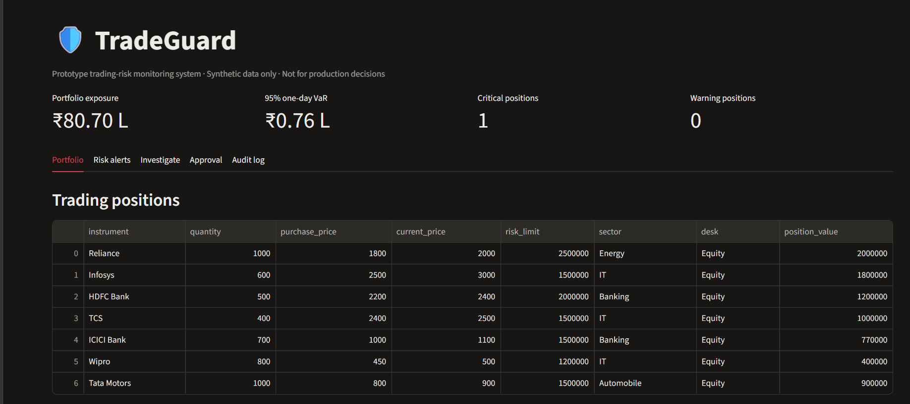
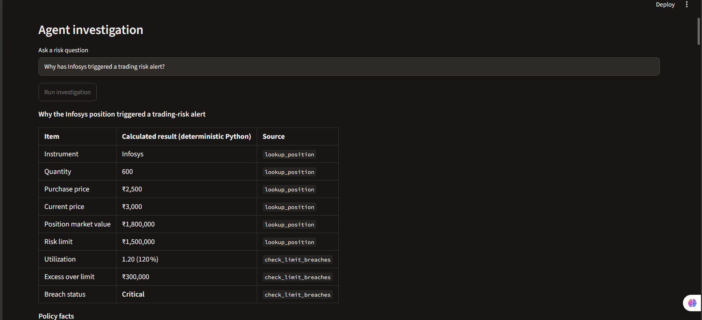

# TradeGuard – Agentic AI Trading Risk Monitor

TradeGuard is an agentic AI-powered trading risk monitoring system that analyzes portfolio exposure, detects risk-limit breaches, and assists with risk investigations through AI-generated explanations and human approval.

Built using LangGraph, MCP, RAG, and Groq, it combines deterministic risk calculations with an AI agent to create an explainable risk monitoring workflow.

## Features

- Portfolio exposure and sector concentration analysis.
- Automated Normal, Warning, and Critical risk-limit detection.
- Historical Value at Risk (VaR) and stress testing.
- LangGraph-based agentic risk investigation.
- Five MCP tools for risk analysis.
- RAG-based policy retrieval using ChromaDB.
- Human-in-the-loop approval using interrupt/resume.
- SQLite-based audit logging.

## Screenshots

### TradeGuard Dashboard


### AI-powered Risk Investigation


## Tech Stack

Python | LangGraph | LangChain | MCP | Groq (GPT-OSS-20B) | ChromaDB | Sentence Transformers | Streamlit | SQLite | Pandas | NumPy

## Results

| Metric | Result |
|---|---:|
| Portfolio Exposure | ₹80.70 L |
| Critical Alerts | 1 |
| Warning Alerts | 0 |
| IT Sector Concentration | 39.65% |
| Historical VaR (95%, 1-day) | ₹75,994.11 |
| Infosys Limit Utilization | 120% |

## Evaluation

Evaluated using nine curated questions.

- Tool selection: 9/9
- Numerical accuracy: 6/6
- Evidence provenance: 9/9
- Task completion: 9/9
- Unit tests: 20/20 passed

*Evaluation results apply to the curated test cases and do not represent general LLM accuracy.*

## Run Locally

```bash
git clone https://github.com/YOUR_USERNAME/TradeGuard.git
cd TradeGuard
pip install -r requirements.txt
```

Create a `.env` file using `.env.example` and configure your Groq API key.

Run the dashboard:

```bash
streamlit run dashboard/app.py
```

## Live Demo

Coming soon.

## Disclaimer

This project uses synthetic trading data and illustrative risk thresholds. It is an educational prototype and is not intended for real-world trading or production financial risk management.
